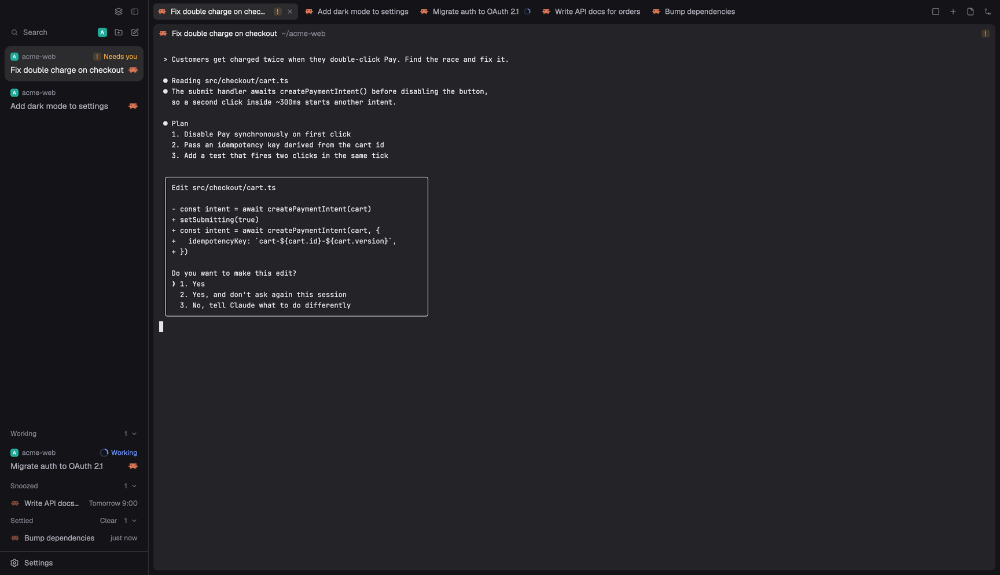

# herdr-t3-code

T3 Code features, rebuilt as mods for [Herdr App](https://herdr.dev).

Each folder in `mods/` is one mod. Install the ones you want, or all of them together with the T3 layout.



## Mods

| Mod | What it brings from T3 Code | Use it |
| --- | --- | --- |
| [`t3-focus`](mods/t3-focus) | The agent inbox. Agents that need you sit on top, busy ones fold into Working, finished ones get settled. Adds snooze, mark unread, multi-select, `cmd-1`…`cmd-9` jump keys, a PR badge per card, and dragging an agent into another one's prompt as a reference. | alone or in the layout |
| [`t3-theme`](mods/t3-theme) | The theme editor. Pick a base theme, change its colors with a live preview, save it as your own. | alone or in the layout |
| [`t3-spaces`](mods/t3-spaces) | Projects in the sidebar, with the project's favicon as its icon and worktrees under their checkout. | in the layout, with `t3-menu` |
| [`t3-menu`](mods/t3-menu) | The space menu, including **Icon…** to pick a favicon, an image or a built-in icon. | with `t3-spaces` |
| [`t3-agents`](mods/t3-agents) | The agents list, grouped by space or priority, with pins. | in the layout |
| [`t3-tabs`](mods/t3-tabs) | Slim tabs, a one-agent view, and the Files and Changes panel. | in the layout |
| [`t3-pane`](mods/t3-pane) | Pane headers with name, folder and status. They also take dropped agent references. | in the layout |
| [`t3-new-menu`](mods/t3-new-menu) | The `+` menu: pick a project, then a terminal or an agent. | in the layout |
| [`t3-chrome`](mods/t3-chrome) | The sidebar frame and the switch between Focus and Spaces + Agents. | in the layout |

`layouts/herdr-t3.json` puts all of them together. `extras/` has a matching theme and an optional `pulls-review` mod.

## Install

The quickest way is to ask your Herdr agent:

> Install the mods from github.com/dogebonker/herdr-t3-code into ~/.config/herdr-app, merge its keys.json into mine, run `herdr-app check` on each mod and switch to the herdr-t3 layout.

Ask for single mods by name instead if you only want those.

By hand, everything:

```sh
git clone https://github.com/dogebonker/herdr-t3-code
cd herdr-t3-code
H=~/.config/herdr-app
cp -R mods/t3-* "$H/mods/"
cp layouts/herdr-t3.* "$H/layouts/"
cp extras/themes/herdr-t3.json "$H/themes/"
jq -s '.[0] * .[1]' "$H/keys.json" keys.json > /tmp/herdr-keys.json && mv /tmp/herdr-keys.json "$H/keys.json"
herdr-app do layout.switch --name herdr-t3
```

For one mod, copy only its folder, for example `cp -R mods/t3-theme "$H/mods/"`. Mods reload on save, so Herdr doesn't need a restart. Nothing here overwrites your other mods or layouts.

## Keys

These are in the `layout:herdr-t3` section of `keys.json`, so they apply only in the T3 layout.

| Key | Does |
| --- | --- |
| `cmd-1` … `cmd-9` | Open the Nth Focus card (replaces tab switching in this layout) |
| `cmd-shift-s` | Settle the agent in view, or bring it back |
| `cmd-shift-b` | Switch the sidebar between Focus and Spaces + Agents |
| `cmd-shift-a` | One-agent view on or off |
| `cmd-shift-e` | Files and Changes panel |
| `cmd-shift-t` | Theme editor |

## Focus in short

- Hover a finished card and click **Settle** to put it away. New work brings it back.
- Click the clock on a card to **snooze** it. Pick a preset, a date and time, or type `2h`, `fri 10:00` or `nov 12 9:00`.
- **Right-click** a card for Mark unread, Pin, Settle, Snooze and Reference in focused agent.
- **cmd-click** or **shift-click** to select several cards, then act on all of them.
- **Drag** a card to reorder, pin or settle it. Drag it out of the sidebar onto another agent's pane header to paste a reference to it there.

## Updating

Herdr installs a renamed copy when a mod already exists, so update by copying the new files over the old ones with the same commands. Pins, snoozes, settled agents and space icons live in `data/`, `shared.json` and terminal labels, so they survive an update.

## Adding a mod

New T3 features go in as their own `mods/t3-<name>` folder:

1. Name what it mirrors from T3 Code and keep to Herdr's mod API (`herdr.d.ts` and `AGENTS.md` in `~/.config/herdr-app`).
2. Add a `check-<name>.cjs` test against a fake API, like `mods/t3-focus/check-focus.cjs`, and make `herdr-app check mods/t3-<name>` pass.
3. Add a row to the table above, and its keys to `keys.json` if it has any.

Tests:

```sh
node --test mods/t3-focus/check-focus.cjs
node --test mods/t3-theme/check-theme.cjs
node mods/t3-spaces/check-icons.cjs
```

`check-sidebar.cjs` and `check-pane.cjs` need Herdr's built-in icons, so run them from the installed copies in `~/.config/herdr-app/mods/`.

## License

Apache-2.0. See [LICENSE](LICENSE) and [NOTICE](NOTICE).
