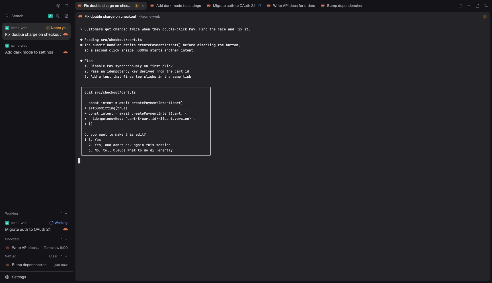

# Herdr T3

A dark window for running many coding agents. A 256px sidebar on the left shows either your spaces and agents, or a Focus list of only the agents that want you. On the right, tabs run along the top and the terminals sit in rounded frames with a header each. The Focus list lets you settle finished agents, snooze one until later, mark one unread, pin and reorder, and drag an agent onto another agent's pane to reference it. It comes with its own theme, a theme editor, and space avatars that use each project's favicon.



This file is the brief: enough to build Herdr T3 from an empty folder. The files next to it are one build of it. If they don't work on your Herdr, or you want it different, build it again from here.

## What you see

No system title bar. The macOS window buttons sit at 16, 13 over the sidebar. Colors are the theme's tokens, and `themes/herdr-t3.json` sets them to:

| Token | Hex | Token | Hex |
| --- | --- | --- | --- |
| `canvas`, `chrome` | `#141418` | `background` (terminals, frames) | `#232328` |
| `selected` | `#2c2c2f` | `hover` | `#202024` |
| `border` | `#353539` | `input` | `#3b3b40` |
| `muted` | `#a9a9b4` | `dim`, `idle` | `#83838f` |
| `accent`, `working` | `#6b93ff` | `blocked` | `#f0a33a` |
| `done`, `solid` | `#ececf0` | terminal text | `#e6e6ea` |
| `popover` | `#232327` | `selection` | `#2f4170` |

Left to right, with a 1px `border` divider between the two sides:

1. **The sidebar**, 256px, on `chrome`, not resizable.
   - **The top bar**, 40px, drags the window. At its right edge, 10px in: two 26px buttons with 14px `dim` icons. The first switches the sidebar between its two views (a layers icon while Focus shows, a circle check while the lists show). The second hides the sidebar.
   - **The lists** (shown at first): Spaces above Agents, sharing the height evenly, each at least 90px.
     - **Spaces**: a 32px heading, "Spaces" in 12px medium `muted` with a 26px plus at the right. Then 30px rows with 8px corners: an 18px avatar, the name (up to 150px, `foreground`), and at the right, in 11px `dim`, only what is unusual: the repo name if it differs from the space name, the branch if it isn't `main` or `master` or the name, `↑2` in `ansi2` and `↓1` in `ansi1`. A worktree space sits under its checkout, indented 20px, hung from the checkout's avatar by a 1.5px `input` line with a rounded turn, and shows a branch icon instead of an avatar. The active space has a `selected` fill. Once another machine is known, the rows group under 30px headers: a monitor or server icon, "This computer" or the machine name, its state when not connected, a plus, a 6px dot (`ansi2` connected, `dim` not) and a chevron.
     - **Agents**: a 1px `border` line on top, a 31px heading, "Agents" in 12px medium `muted`, and a 26px sort button. Then 30px rows: the program's 16px icon, the agent's name, the space in 12px `dim` when no space header is above, the machine for a remote agent, the time in its state ("<1m", "5m", "2h", "3d") and a status mark. Sub-agents sit under their parent, indented 20px per level, with the same tree lines. Group headers are 11px medium, 22px for the first and 30px after.
   - **Focus** (the other view, same place): see the Focus section below.
   - **The footer**, 41px, a `border` line above: one 30px Settings row with a 16px gear, plus a 6px `accent` dot that appears once Herdr has an update waiting.
2. **The work area**, the rest of the width.
   - **The tab bar**, 40px, on `chrome`, drags the window. On macOS without a title bar it pads its left edge so the tabs clear the window buttons even when the sidebar is narrow or hidden. Tabs are 28px, 8px padding, 6px corners, 13px text: the lead pane's program icon, the name (up to 170px, " Z" added when zoomed) and a status mark. The active tab is `selected` with `foreground` text and a close cross. Others are `chrome` with `muted` text. At the right, 26px buttons: the agent view toggle, a plus, Files and Changes (filled `selected` while open), and minimize, maximize and close when the system draws no window buttons (`window().buttons`). Windows gets SVG buttons, other systems get "−", "□" and a cross.
   - **The terminals**, with 2px above and 8px on the sides. Each pane is a frame on `background` with 8px corners and 8px gaps, even when a tab has one pane. The border and focus border are 2px of `background`, so there is no focus ring. Terminals have 8px side padding and draw no background of their own.
   - **The pane header**, 28px, always shown, on top of each frame: the program's 14px icon, the name in 13px medium (`foreground` for the focused pane, `muted` otherwise, up to 260px), the folder in `dim` with your home as `~`, and a status mark.
   - A 6px empty strip at the bottom.
   - **The side panel** (hidden at first), 368px, between 280 and 900px: Herdr's Files or Changes.
   - **The status bar** (hidden), 28px: Herdr's `workspace-status`.

The status marks are the same in the agents list, tabs and pane headers:

| Status | Mark |
| --- | --- |
| working | a 12px spinner in `working` |
| blocked | a 14px "!" tile in bold 11px `blocked` on `blocked` at 15%, 4px corners |
| done | a 7px dot in `done` |
| idle | in the agents list only, a 7px ring with a 1.5px `idle` border |

### Focus

The Focus view fills the sidebar between the top bar and the footer, on `chrome`, 13px text.

- **A top row**, 32px: a Search pill that opens Herdr's picker, then 26px buttons for the space filter (a list icon, or the avatar of the space it filters to), New space and New agent.
- **The cards**: agents that want you, newest news first, 2px apart, in a list with 8px padding. A card has 10 by 8px padding and 10px corners. Line one, 20px, 12px `dim`: a 14px avatar with 4px corners, a pin glyph if pinned, the space name (and `· machine` for a remote agent), and a status corner. Line two: the title at 14px, `foreground` for the agent in view and `muted` for the rest, then the 16px program icon. Line three when it has something: a PR badge, the branch, "2 sub-agents working". The card in view is `selected`, picked cards are `accent` at 15%.
- **The shelves**, pushed to the bottom. Each has a 30px header in 12px medium `dim` with the count and a chevron at the right. Working holds full cards. Snoozed holds 30px rows with the wake time ("18:00", "Tomorrow 9:00", "Mon 9:00", "Nov 12 9:00"). Settled holds 30px rows with how long ago ("just now", "5m", "2h", "3d") and a Clear button in its header.

A card's corner says Working with a 16px spinner and the run time (9s, 4m, 1h 5m) in `working`. Or Needs you with the "!" tile in `blocked`. Or Woke with a clock pulsing between 45% and 100% in `accent`. Or Done with a circle check in `ansi2`. Otherwise it shows how long ago it changed. The PR badge is `#123` in `ansi2` (open), `dim` (draft), `ansi5` (merged) or `ansi1` (closed), then a check (`ansi2`), a cross (`ansi1`) or a 6px `working` dot for the checks.

Empty: "Nothing needs you."

## How it behaves

**Keys** (all in the `layout:herdr-t3` section):

| Key | Does |
| --- | --- |
| cmd-shift-b | switch the sidebar between the lists and Focus |
| cmd-shift-a | switch the work area between the tabs and one agent full size |
| cmd-shift-s | settle the agent in view, or bring back a settled one (while Focus shows) |
| cmd-shift-e | show or hide the side panel |
| cmd-shift-t | open the theme editor |
| cmd-1 to cmd-9 | focus the Nth Focus card (while Focus shows) |

**The sidebar.** The top bar's first button and cmd-shift-b switch the `sidebar-lists` stack. The second button hides the sidebar. While it is hidden, the tab bar starts with a sidebar button that also shows how many agents need you, are working and are done, each with its mark.

**Spaces.** Click selects the space. Press one and release on another space of the same machine to move it there, with a 2px `accent` line showing where. Right-click opens a 200px menu: Rename, New worktree and Open worktree (in a git repo), Remove worktree (in a worktree), Icon… and Close, with ↑ ↓ Enter and Esc. Hover a checkout with worktrees and its avatar becomes a chevron that folds them. Folded, a count at the right opens them again. Machine headers fold too, and their plus makes a space there.

A space's avatar is, in order: the icon picked for it, its project's favicon, or its first letter in white bold on its color. New spaces get the least-used color of `ansi6`, `ansi3`, `ansi4`, `ansi5`, `ansi2`, `ansi1`, drawn as `#22a99a`, `#e3814f`, `#5b8def`, `#8b7cf6`, `#3fae6a`, `#d9649a`. Icon… opens a 420 by 520 dialog: Automatic (the favicon, else the letter), Letter, a dashed box to drop an image on or type its full path into, and a grid of Herdr's own icons drawn white on the space's color. Done closes it.

Git info updates when a space is new or its terminal changes folder, when a command or an agent's turn ends there, when a machine comes back, when the repo's git folder changes, and once a minute while Herdr is the focused app.

**Agents.** Click runs `agent.focus`. Click a sub-agent to peek at it. The sort button opens a 200 by 140 popup with Priority and Grouped by space. Priority groups the agents under Needs you (in `blocked`), Done, Working and Idle, most urgent first, with Idle folded. Grouped puts them under their space names. Pinned agents sit in their own group on top. Hover a row and its time becomes a pin button. A parent with sub-agents has a fold arrow, folded at first with a count, and its status shows the most urgent hidden sub-agent. A blocked sub-agent stays visible under a folded parent. A done agent you look at stays under Done until you leave it.

**Tabs.** Click selects. Double-click renames. Press one tab and release on another to move it. Right-click opens Herdr's tab menu. The scroll wheel goes to the next or previous tab. The plus opens the New menu. Files and Changes open the side panel on that view, and the panel's state is remembered per space.

A tab shows the done dot only while its agent is done and not settled or snoozed in Focus. An agent marked unread shows the dot too, in the tab and its pane header.

**The agent view.** The view toggle and cmd-shift-a show one agent full size in a frame with 8px corners. The tab bar then shows that agent's icon, name, space and mark, the scroll wheel moves between agents, and clicking a space shows that space's agent. A new shell pane in the current space brings the tabs back with that pane focused. Starting anything from the New menu brings the tabs back too.

**Pane headers.** Click focuses the pane. Hover shows four 26px buttons: split right, split down, zoom or unzoom, close.

**New menu.** A popup at the top, 40px down, 520 by 420. A "Search spaces…" field, then the current space, "New space" and the other spaces, each with an 18px avatar, its machine and folder, and `⌘1` to `⌘9`. Picking one shows "Start": Terminal, then the agents installed on that machine with `1` to `9`. Backspace goes back. Enter or a digit starts it in a new tab of that space, or in a new space.

**Focus.**

- A parent takes the most urgent state of itself and its live sub-agents. Blocked, done and idle agents are Active cards, newest first by when they came back to you. Running agents go to Working, newest run first, and stay there 2 seconds after they stop. Pinned agents stay on top in pin order.
- Click focuses the agent. Cmd-click and shift-click select cards, and the next action takes them all. Esc clears.
- Hover a card for a clock button to snooze it and a `⌘N` hint. A finished, unpinned card also offers "Settle" in its corner.
- **Settle** puts the agent on Settled and moves focus to the next card if it was in view. New work, or another ended turn, brings it back on top by itself. A settled row's hover undo brings it back by hand. Press Settle and drag across cards to settle them all. Settled shows 10, then "Show N more" adds 25.
- **Clear** asks first ("Clear 3?" in `blocked`), then closes the panes of settled agents that aren't in view or in the current tab. If that would empty a space, a shell tab opens there first.
- **Snooze** opens "Snooze until": In 1 hour, In 3 hours, This evening (before 18:00 only), Tomorrow 9:00, Next week (Monday 9:00), "Pick date & time…" (a month grid and a time field, default 9:00), and a field that reads "30m", "14:30", "tomorrow 8:00", "fri 10:00", "nov 12", "12/11 14:00" or "2026-11-12 9:00". Blocked and pinned agents can't be snoozed. When the time comes the agent wakes on top of Active with Woke, and a "Snooze over" notification focuses it. It wakes early, without a notification, if it or a sub-agent becomes blocked. Hover a snoozed row to wake it now.
- **Right-click** opens a 220px menu: Mark unread, Reference in focused agent, Pin or Unpin, Settle or Un-settle, and the snooze choices. **Mark unread** shows the agent as Done until it is looked at again.
- **Drag** a card 6px to lift it. Pinned and Active labels open, a gap shows where it will land, and the card's corner says Pin, Unpin, Settle or Un-settle. Drop to reorder pins, settle or bring back. Esc puts it back.
- **Reference**: drag a card out of the sidebar's right edge. For 10 seconds every other agent's pane header turns into "Drop to reference <name>" on `accent` at 10% with a 40% `accent` border. Release or click on one and the reference goes into that agent's prompt without Enter: `[agent t3 "Fix double charge on checkout" · ~/acme-web · read it with: hc read t3]`. Esc, a press elsewhere or 10 seconds cancel it. "Reference in focused agent" does the same without a drag.
- **Motion:** cards and shelf rows fold and grow over 180ms ease-out, menus fade in over 120ms, drag gaps open over 150ms.

**Theme editor.** cmd-shift-t opens an 880 by 640 dialog with a hex field and swatch per theme color, a live preview, Start from chips for every theme, and Import from JSON. Save writes `themes/<name>.json` and switches to it. Cancel and Esc change nothing.

## Built from

- **The layout** (`layouts/herdr-t3.json`): root `row`, `background: "canvas"`, `titlebar: "none"`, `traffic_lights: [16, 13]`, `divider: { width: 1, color: "border" }`, `terminal_padding: [8, 0]`, `terminal_opacity: 0`, `preview: "layouts/herdr-t3.svg"`. It names no theme.

  ```
  root (row)
  ├─ sidebar (column, 256px, min 208, max 480, background chrome, not resizable)
  │  ├─ brand        block 40px, window_drag      t3-chrome
  │  ├─ sidebar-lists (stack, active "lists")
  │  │  ├─ lists (column)
  │  │  │  ├─ spaces  block weight 1, min 90     t3-spaces
  │  │  │  └─ agents  block weight 1, min 90     t3-agents
  │  │  └─ focus      block                      t3-focus { newMenu: "t3-new-menu" }
  │  └─ sidebar-footer block 41px                t3-chrome { footer: true }
  └─ work (column, not resizable)
     ├─ tabs          block 40px, window_drag    t3-tabs
     ├─ work-body (row, padding [2, 8], gap 8)
     │  ├─ view (stack, active "main")
     │  │  ├─ main    { tab: "active", pane: { header: { content: { mod: "t3-pane" }, reveal: "always", height: 28, position: "top" },
     │  │  │            background: "background", border: { width: 2, color: "background" },
     │  │  │            focus: { width: 2, color: "background" }, radius: 8, gap: 8, lone: true } }
     │  │  └─ agent   { agent: "focused" }, background "background", radius 8
     │  └─ panel (column, 368px, min 280, max 900, hidden)
     │     └─ panel-body (stack, active "files"): files (mod files), changes (mod changes)
     ├─ work-bottom-inset (empty row, 6px)
     └─ status        block 28px, hidden        workspace-status
  ```

  The mods find these nodes by id: `sidebar`, `sidebar-lists` (with children `lists` and `focus`), `view` (with `main` and `agent`), `panel` and `panel-body`.
- **The theme** (`themes/herdr-t3.json`): background `#232328`, foreground `#e6e6ea`, selection `#2f4170`, cursor `#e6e6ea`, ANSI `#3a3a40 #ff6b64 #4fd17a #f2c14e #6b9bff #d07cf0 #4cc9e0 #c9c9cf` and brights `#6c6c78 #ff8a84 #74e397 #ffd479 #8fb3ff #e09cf7 #7fdcec #f5f5f7`, and the `colors` in the table above (plus `surface` `#232328`, `raised` `#404047`, `accent_foreground` and `solid_foreground` `#161618`, `unknown` `#83838f`).
- **`keys.json`**: the table above, as one `layout:herdr-t3` section with `t3-chrome.sidebar`, `t3-tabs.view`, `t3-focus.settle`, `layout.toggle:panel`, `mod.open:t3-theme` and `t3-focus.jump-1` to `-9`.
- **Nine mods.** Seven are clones of shipped mods (`cloned_from` in their `mod.json`): `t3-agents` of `agents`, `t3-chrome` of `workspace-chrome`, `t3-menu` of `menu`, `t3-new-menu` of `new-menu`, `t3-pane` of `pane`, `t3-spaces` of `spaces`, `t3-tabs` of `tabs`. `t3-focus` and `t3-theme` are new. All are `place: "none"`.
  - **`t3-chrome`**: the top bar, and with `props.footer` the Settings row (`app.settings`, `updates().app.ready`). Takes `t3-chrome.sidebar` through `nextCommand()` in the top bar's copy only. Runs `layout.select` on `sidebar-lists` and `layout.toggle` on `sidebar`. Art: `settings.svg`.
  - **`t3-spaces`**: the spaces list. Uses `spaces`, `panes`, `agents`, `machines`, `window().active`, `watchFolder` on each local repo's git folder, `readTextFile`, and `space.select`, `space.move`, `space.new`, `agent.focus`, `layout.select`. Writes shared `space.colors`, `space.favicons`, and prunes `space.icons`. Runs `git --no-optional-locks -c core.fsmonitor=false status --porcelain=v2 --branch`, `git rev-parse --show-toplevel` and `git rev-parse --path-format=absolute --git-common-dir` in each space's folder (on its machine for a remote one), one place at a time. Runs `hc machine ls --json` every 15 seconds. Looks for a favicon in local projects: well-known files (`favicon.svg`, `public/favicon.ico`, `app/icon.png`, `src/app/icon.svg`, `assets/logo.png`, `AppIcon.icns` and more), then a `<link rel="icon">` in `index.html` or a route file, only inside the project. Turns it into a 64px PNG with `sips -s format png -Z 64 <src> --out data/space-icons/<hash>.png`, once per source path.
  - **`t3-agents`**: the agents list. Shared `agents.pins` (with Focus) and `agents.sort`. Calls `setAgentOrder` while the lists show. Runs `agent.focus` and `terminal.peek`. Opens itself as the sort popup with `props.sortMenu`.
  - **`t3-focus`**: the Focus view. Keeps its state as labels on the agents' terminals, written with `hc label <address> settled=<ms>:<turn>`, `snoozed=<wake ms>:<ms>` and `unread=<ms>`, which the tabs and pane headers read too. Shared `agents.pins` and `focus.ref`. Calls `setAgentOrder` while Focus shows. Takes `t3-focus.settle`, `t3-focus.jump-1` to `-9` and `t3-focus.reference` through `nextCommand()`. Runs `gh pr view <branch> --json number,state,isDraft,statusCheckRollup,url` in each card's folder, two at a time, again after 3 minutes, never while drawing. Posts the snooze notification with `notify`. Pastes a reference with `cx.write_to_clipboard`, `terminal.paste`, and puts the old clipboard text back 500ms later. Uses `Popover`, `Popup`, `InputState`, `Input` and `CalendarState` from `gpui-base`. Art: `undo.svg`, `list-filter.svg`.
  - **`t3-tabs`**: the tab bar. Takes `t3-tabs.view`. Runs `tab.select`, `tab.move`, `tab.rename`, `tab.close`, `tab.next`, `tab.prev`, `agent.next`, `agent.prev`, `agent.focus`, `pane.focus`, `layout.select`, `layout.show`, `layout.hide`, `layout.toggle`, `mod.open` and the window commands. Reads shared `workspace.panels` (default Files and Changes). Opens the shipped `menu` for a tab's right-click. Art: `win-min.svg`, `win-max.svg`, `win-restore.svg`, `win-close.svg`.
  - **`t3-pane`**: the pane header, given `{ pane, terminal }` by Herdr. Runs `pane.focus`, `pane.split`, `pane.zoom`, `pane.close`. Shows a drop target while `focus.ref` is set, has no `to`, is under 10 seconds old and belongs to another agent. On press or release it sets `to` to its pane and runs `t3-focus.reference`. Art: `split-right.svg`, `split-down.svg`, `zoom.svg`, `unzoom.svg`, `close.svg`.
  - **`t3-menu`**: the space menu and its Icon dialog. Runs `git rev-parse` to tell a checkout from a worktree, opens the shipped `worktree` dialog, and writes shared `space.icons`. Lists `icons/*.svg` in the Herdr folder. A dropped or typed image goes through the same `sips` step into `data/space-icons/`. Art: `image.svg`.
  - **`t3-new-menu`**: the New popup (`overlay: { kind: "popup", at: "top", offset: 40, width: 520, height: 420 }`). Uses `knownAgents({ on: machine })` for what is installed, cached per machine in local storage, and runs `space.new` or `tab.new` with the agent's `run` as `argv`.
  - **`t3-theme`**: the theme editor (`overlay: { kind: "dialog", modal: true, width: 880, height: 640 }`). Reads and writes `themes/<slug>.json` with `readTextFile` and `writeTextFile`, then runs `app.theme`.
- **Shared files copied into several mods**, because a mod can't import from another's folder: `space-icon.js` (the avatar rule) in `t3-spaces`, `t3-focus`, `t3-menu` and `t3-new-menu`, and `name.js` (an agent's or pane's name: its `pi.session` label, a tab someone named, a terminal title that says something, else the program) in `t3-focus`, `t3-agents`, `t3-tabs` and `t3-pane`. `t3-spaces/check-icons.cjs` fails if the copies differ.
- **Shipped mods it uses:** `files`, `changes`, `workspace-status`, `menu`, `worktree`, `picker`, and the art in `mods/workspace-chrome/`, `mods/pane/close.svg`, `mods/files/file.svg`, `mods/changes/changes.svg` and `icons/shell.svg`.
- **Art:** the SVGs above (24px stroke icons in `currentColor`), and `layouts/herdr-t3.svg`, a 640 by 400 drawing of the window for the layout picker.

What the mods reach outside themselves, to tell the person before adding:

| Mod | Programs | Network | Files outside its folder | Clipboard |
| --- | --- | --- | --- | --- |
| `t3-focus` | `gh` (`exec`), `hc label` | `gh` asks GitHub about each card's branch | none | yes, for references, restored after 500ms |
| `t3-spaces` | `git`, `sips` (`exec`), `hc machine ls` | none | reads project folders for favicons, watches repos' git folders, writes `data/space-icons/` | no |
| `t3-menu` | `git`, `sips` (`exec`) | none | reads `icons/` and the image you give it, writes `data/space-icons/` | no |
| `t3-theme` | none | none | reads and writes `themes/` | no |
| `t3-new-menu` | none (Herdr's `knownAgents` asks the shell what is installed) | none | none | no |
| `t3-agents`, `t3-chrome`, `t3-pane`, `t3-tabs` | none | none | none | no |

`git` runs on the space's own machine for a remote space. `t3-focus` also opens a PR's page in the browser when you click its badge.

## Watch out

- **The layout names no theme.** `themes/herdr-t3.json` is named like the layout, so Herdr offers it in Settings only while this layout shows. Pick it there.
- **cmd-1 to cmd-9 are Herdr's tab keys.** This layout takes them for the Focus jumps, only while it shows.
- **The Focus keys need Focus showing.** A mod command reaches only shown copies, so cmd-1 to cmd-9 and cmd-shift-s do nothing while the lists show. The lists show at first (the preview shows Focus). Press cmd-shift-b.
- **Both sidebar views stay alive once shown.** The stack keeps the hidden one running, so each list sets the `agent.next` order only while it is the stack's active child.
- **Herdr reports no mouse release outside the sidebar.** A Focus drag ends when the pointer leaves: off the top or bottom it lands, off the left it goes back, off the right it arms a reference.
- **Pane header drops depend on `t3-pane`.** The `focus.ref` handshake is shared state plus the `t3-focus.reference` command. A reference older than 10 seconds is stale, so a header must check its age.
- **`sips` is macOS only.** Elsewhere favicons and picked images fail and the letter shows. Favicons are looked up only for spaces on this computer. A changed favicon keeps its old picture until `data/space-icons/` is cleared.
- **`git status` walks the whole tree.** Ask only when the answer could have changed (see Spaces above) and never with optional locks or fsmonitor, or the watch on the git folder wakes itself.
- **The clipboard restore is a guess.** The old text comes back after 500ms, and an image on the clipboard is lost.
- **PR lookups are keyed by folder and branch.** Two panes in different subfolders of one repo ask `gh` twice. No `gh`, not signed in, or no PR shows no badge and no error.
- **`t3-menu` still carries pane, tab and global item lists from the shipped menu.** This layout only opens it for spaces. Tabs use the shipped `menu`.
- **The status bar is hidden** and no key in `keys.json` shows it.
- **The pane focus border is the background color**, so the focused pane is told apart by its header's brighter name, not a ring.
- **The sidebar is fixed at 256px** (`resizable: false`), although it has a min and max.
- **A transition only animates a change.** A new element is drawn at its start values for one frame, then at its own.
- **`t3-spaces/check-sidebar.cjs` reads the shipped art from disk**, so it fails when run from this repo instead of a Herdr folder.

## Done when

- `herdr-app check` passes for each of the nine mods. `node --test` passes for `check-focus.cjs`, `check-pane.cjs`, `check-icons.cjs` and `check-theme.cjs`.
- `layout.switch herdr-t3` shows the sidebar, tabs and framed panes, and choosing the herdr-t3 theme gives the colors above.
- A space in a git repo on a side branch shows the branch and `↑N` after a commit. A worktree space sits under its checkout with the tree line.
- A project with `public/favicon.svg` shows its favicon as the space avatar in Spaces, Focus and the New menu.
- An agent going working, blocked and done updates its mark in the agents list, its tab and its pane header together.
- cmd-shift-b shows Focus. A finished agent settled there drops its done dot from the tab and pane header.
- With Focus showing, cmd-1 jumps to the top card, and cmd-shift-s puts away the agent you're looking at.
- A snooze a minute ahead wakes with a notification and the Woke corner.
- Dragging a card out of the right edge turns other agents' pane headers into drop targets, and dropping types the reference into that agent without pressing Enter.
- cmd-shift-a shows the agent view and back. cmd-shift-e opens and closes Files.
- cmd-shift-t opens the theme editor, and Save creates a theme file and switches to it.
