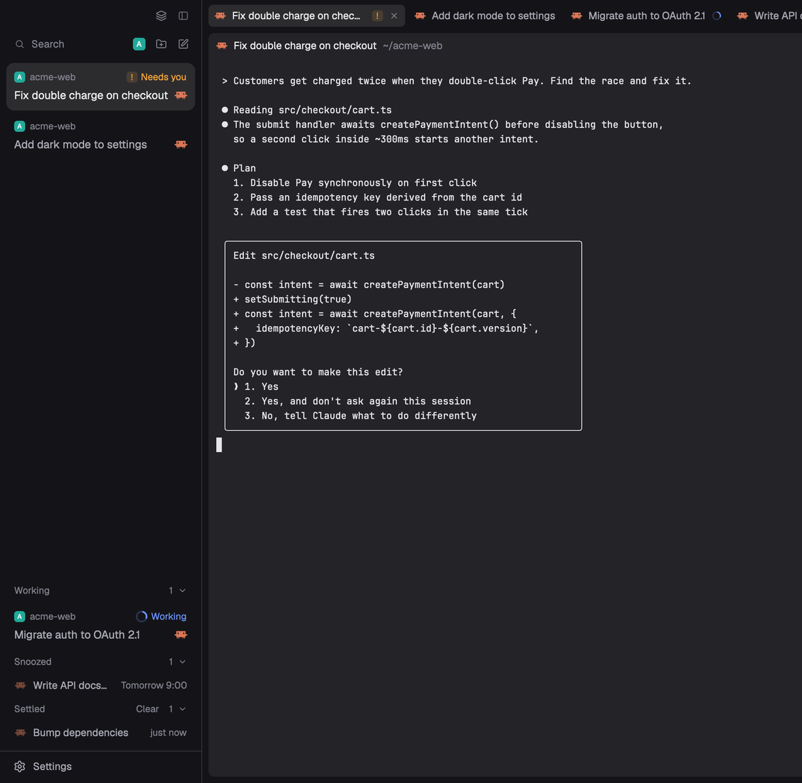

# T3 Focus

A 300px sidebar on the left that shows only the agents that want you. Each one is a card, newest news on top. Below the cards, Working, Snoozed and Settled shelves hold the agents that don't need you right now. You can settle a finished agent, snooze one until a time, pin, reorder, mark one unread, or drag a card out to reference it in another agent. This is a piece you add to your current layout, not a whole window.



This file is the brief: enough to build T3 Focus from an empty folder. The files next to it are one build of it. If they don't work on your Herdr, or you want it different, build it again from here.

## What you see

Top to bottom, on the theme's `chrome` background, 13px text:

1. **The top row**, 32px, 8px padding left and 10px right. A Search pill fills the row (search icon and "Search", `dim` text, `hover` fill). Then three 26px buttons with 14px icons: the space filter, New space and New agent. The filter shows a list icon, or the avatar of the one space it filters to, or two overlapping avatars when it filters to several.
2. **The cards**, in a list with 8px padding that scrolls. A card is 10px by 8px padding, 10px corners, 2px apart:
   - First line, 20px, 12px `dim` text: a 14px space avatar with 4px corners, a pin glyph if pinned, the space name (with `· machine` for an agent on another machine), and a status corner on the right.
   - Second line: the agent's title at 14px, `foreground` for the agent in view and `muted` for the rest, then the program's 16px icon.
   - Third line, only when there is something to say, 12px `dim`: a PR badge, the branch, and "2 sub-agents working".
   - The card in view has a `selected` fill. Others get a `hover` fill under the pointer. Cards picked with cmd or shift have `accent` at 15% opacity.
3. **The free space**, pushing the shelves to the bottom.
4. **The shelves**, each with a 30px header in 12px medium `dim` text: label on the left, then the count and a chevron at the right edge.
   - **Working**: full cards for agents that are running.
   - **Snoozed**: 30px rows with the program icon at half opacity, the title in `muted`, and the wake time on the right ("18:00", "Tomorrow 9:00", "Mon 9:00", "Nov 12 9:00").
   - **Settled**: 30px rows in the same style with how long ago it was settled ("just now", "5m", "2h", "3d"). The header has a Clear button before the count.

Empty Active list: "Nothing needs you." If no agent has reported status yet: "No agent status yet. Agents show up here when they report their status."

The status corner of a card says one of these:

| Corner | Look |
| --- | --- |
| Working | 16px spinner, "Working" and the time since it started (9s, 4m, 1h 5m) in the terminal font, all in `working` |
| Needs you | a 14px "!" tile on `blocked` at 15%, "Needs you" in `blocked` |
| Woke | a 14px clock pulsing between 45% and 100% opacity, "Woke" in `accent` |
| Done | a 16px circle check and "Done" in `ansi2` |
| otherwise | how long ago it last changed, plain |

The PR badge is `#123` in the state's color: open `ansi2`, draft `dim`, merged `ansi5`, closed `ansi1`. A 10px check in `ansi2` follows for passing checks, a 10px cross in `ansi1` for failing ones, a 6px `working` dot for pending ones.

## How it behaves

**Where an agent goes.** A parent takes the most urgent state of itself and its live sub-agents (an error in a sub-agent reads as blocked, and a sub-agent finishing reads as idle, because that news belongs to the parent).

- Blocked, done or idle agents sit in Active, newest first by when they came back to you. Blocked shows as Needs you, done as Done.
- Running agents, and parents waiting on a working sub-agent, go to the Working shelf, newest run first. An agent that stops stays on Working for 2 seconds, so a quick continuation doesn't jump twice.
- Pinned agents stay at the top of the cards in pin order, whatever their state.
- Snoozed agents sit on Snoozed, soonest wake first. Settled agents sit on Settled, most recent first.
- All three shelves start folded and remember their fold. A folded shelf still shows the agent in view.

**Clicks and keys.**

- Click a card or row: `agent.focus` on it. Cmd-click toggles a card in the selection, shift-click adds the range from the last cmd-clicked card. While a selection exists the sidebar takes the keyboard, and Esc clears it and gives focus back. A plain click ends it.
- Hover a finished, unpinned card: the corner turns into "Settle" with a check. Hover also shows a clock button for snoozing (not on blocked or pinned cards) and a `⌘N` hint for the first nine cards.
- `t3-focus.settle` (cmd-shift-s): puts away the agent on screen when it's finished and not pinned, and un-settles it when it's already settled. After putting away the agent on screen, focus moves on to the card below it, and from the last card back to the first.
- `t3-focus.jump-1` to `t3-focus.jump-9`: focus the Nth card, counting pins, then Active, then the Working cards shown.
- Search opens the `picker`. New space opens the system folder picker (`pickFolder`) and runs `space.new` with the chosen folder. Cancelling makes nothing. Without a folder, `space.new` would start in the focused terminal's folder. New agent opens `new-menu`, or the mod named in the `newMenu` prop.
- The filter opens a 260px popover with a "Search spaces…" field, "All spaces" and each space with its avatar. Click shows that space alone. Shift-click adds or removes a space and keeps the popover open. A check badge marks the chosen ones. The filter is remembered.

**Settle.** Settling writes a label on the agent's terminal, so it lasts as long as the terminal. A settled agent comes back to the top of Active by itself when it or a sub-agent gets busy, or when it ends another turn. Hover a settled row and its time becomes an undo arrow that brings it back. Settled shows 10 rows, then "Show N more" adds 25.

**Sweep.** Press a card's Settle and drag across other finished cards to settle them all on release. Pressing a settled row's undo and dragging does the same for bringing rows back.

**Clear.** The first click turns the button into "Clear 3?" in `blocked`. A second click closes the panes of the settled agents that are not in view and not in the current tab. If that would empty a space, a fresh shell tab opens there first, in the folder its terminals were in. Then the person's space and tab are selected again. The question goes away 400ms after the pointer leaves the button, or after 3 seconds if it was reached without hovering.

**Snooze.** The clock button opens a 240px menu, "Snooze until":

- In 1 hour, In 3 hours, This evening (18:00, only before 18:00), Tomorrow (9:00), Next week (next Monday 9:00), each with its wake time on the right.
- "Pick date & time…" swaps in a month grid: past days faded and not clickable, today outlined, the picked day on `accent`, arrows for the months (no going back before this month). Under it a time field starting at 9:00 and a Snooze button on `solid` that stays faded until the day and time are still ahead.
- A typed field at the bottom with the placeholder "30m, 14:30, fri 10:00, nov 12". It takes spans ("30m", "2h", "in 3 days"), clock times ("14:30", "9", "tomorrow 8:00"), weekdays ("fri", "friday 10:00"), month and day ("nov 12"), "12/11 14:00" in the machine's own day and month order, and "2026-11-12 9:00". A day without a time means 9:00. A time already past today means tomorrow. Enter snoozes. Anything it can't read, or a time in the past, does nothing.

Snoozing an agent in Active folds its card away while its row grows into the Snoozed shelf. Snoozing the agent in view moves focus to the next card. With a selection, every selected card that can be snoozed goes. Blocked and pinned agents can't be snoozed.

Every 15 seconds, and on every draw, due snoozes wake. A woken agent goes to the top of Active with the Woke corner until you look at it, and the mod posts a "Snooze over" notification with the agent and space, whose action is `agent.focus` on it. An agent whose own state or a sub-agent's turns blocked wakes early, with no notification. Hover a snoozed row and its time becomes a "Wake now" arrow, which wakes it without a notification.

**Right-click** a card or row for a 220px menu at the pointer: Mark unread, Reference in focused agent, Pin or Unpin, Settle or Un-settle, then the snooze choices. With a selection the items act on all of it and say "(3)". Each item only shows when it applies.

**Mark unread** brings a settled or snoozed agent back and shows it as Done until it is next looked at.

**Drag.** Press a card (not a Working one) and move 6px to lift it. A copy follows the pointer up and down with an `accent` border and a shadow. "Pinned" and "Active" labels with a line open in the list, the destination's label turns `accent`, a gap opens where the card will land, and the copy's corner says what letting go does: Pin, Unpin, Settle or Un-settle. An empty section shows a dashed 36px box to drop on. Dropping among the pins sets their order. Dropping on Settled settles it, and dragging out of Settled brings it back. A busy agent can't be settled. Esc puts the card back.

Herdr doesn't report a release outside the sidebar, so leaving it decides. Off the top or bottom the card lands where the gap shows. Off the left side it goes back. Off the right side, toward the panes, it arms a reference.

**Reference.** An armed reference waits for 10 seconds. Esc, a press in the sidebar, or a press elsewhere (after 250ms) disarms it. This mod has no pane headers of its own, so in a plain layout nothing takes the drop and the reference just expires. "Reference in focused agent" in the right-click menu does the same thing without a drop target. It focuses the agent in view, puts one line on the clipboard, runs `terminal.paste`, and 500ms later puts the old clipboard text back. Enter is not pressed. The line is:

```
[agent t3 "Fix double charge on checkout" · ~/acme-web · read it with: hc read t3]
```

**Motion.** Folding cards and shelf rows animate height and opacity over 180ms ease-out. Menus and buttons fade in over 120ms. Drag gaps and labels open over 150ms. Spinners turn once every 900ms. All of it is the native `transition`, `loop` and `spin`. The only timer is a 16ms one that flips a new element from its start values to its own, so the transition has a change to animate.

## Built from

- **One mod**, `mods/t3-focus/`. `mod.json` is `{ "place": "left", "size": 300, "title": "Focus" }`, so it docks itself on the left of any layout. Files: `main.js`, `name.js`, `space-icon.js`, `undo.svg` and `list-filter.svg` (24px stroke icons drawn in `currentColor`), and `check-focus.cjs`.
- **A `keys.json` snippet** with one key, merged into the person's:

  ```json
  { "global": { "cmd-shift-s": "t3-focus.settle" } }
  ```

  The jump commands have no key here. Bind `t3-focus.jump-1` to `-9` yourself if you want them.
- **Props:** `newMenu`, the mod New agent opens. Without it, `new-menu`.
- **`name.js`**: one rule for an agent's title. Its `pi.session` label, then the tab's name if someone named it, then a terminal title that says something (not the program name, a path or `user@host`), then the program name.
- **`space-icon.js`**: the avatar. A picked icon from shared `space.icons`, else a favicon from shared `space.favicons`, else the space's first letter in white bold on its color from shared `space.colors`. Color names map to fixed marks (`ansi6` `#22a99a`, `ansi3` `#e3814f`, `ansi4` `#5b8def`, `ansi5` `#8b7cf6`, `ansi2` `#3fae6a`, `ansi1` `#d9649a`), and no color means `ansi6`. Focus only calls `avatar()` from it.
- **State on the terminals**, written with `hc(["label", address, "key=value"])` and read from `terminals()[].labels`:
  - `settled=<ms>:<turn>`, so a later turn shows new work.
  - `snoozed=<wake ms>:<ms>`.
  - `unread=<ms>`.
  - An empty value removes the label. The mod shows the change at once and waits for the core. A failed `hc` posts "Couldn't update the agent".
- **Shared state:** `agents.pins` (pin order) and `focus.ref` (`{ address, title, text, at, to? }`).
- **Local storage:** each agent's last state and when it changed, which shelves are open, the space filter and who woke.
- **Herdr functions:** `agents`, `terminals`, `panes`, `spaces`, `focused`, `layout`, `run`, `hc`, `exec`, `notify`, `theme`, `settings`, `home`, `shared`, `setShared`, `setAgentOrder`, `props`, `nextCommand`. From `gpui-base`: `Popover`, `Popup`, `InputState`, `Input`, `CalendarState`. The clipboard through `cx.read_from_clipboard` and `cx.write_to_clipboard`, and `cx.open_url` for the PR.
- **Commands it runs:** `agent.focus`, `pane.focus`, `pane.close`, `tab.new`, `tab.select`, `space.select`, `space.new`, `mod.open`, `terminal.paste`. Commands it takes through `nextCommand()`: `t3-focus.settle`, `t3-focus.jump-1` to `-9`, and `t3-focus.reference` (sent by a pane header that took a drop).
- **The PR badge:** `gh pr view <branch> --json number,state,isDraft,statusCheckRollup,url`, run with `exec` in the card's pane folder (and on the agent's machine for a remote one). Two at a time, each branch again after 3 minutes, started from a timer and never from drawing. No `gh`, not signed in, or no PR shows no badge.
- **Timers:** every second while a Working card shows, every minute for the times, every 15 seconds for snoozes.
- **Art from shipped mods:** `mods/workspace-chrome/` (search, folder, folder-plus, square-pen, clock, check, circle-check, pin, pin-off, spinner, chevron-left, chevron-right, chevron-down) and `mods/pane/close.svg`.

What it reaches outside itself, to tell the person before adding:

- **Programs:** `gh` through `exec`, and `hc label` on the agents' terminals.
- **Network:** `gh` talks to GitHub for each branch the cards show.
- **Clipboard:** a reference replaces the clipboard for 500ms, then puts the old text back.
- **Browser:** clicking a PR badge opens its URL.
- **Files:** none outside its folder.

## Watch out

- **cmd-1 to cmd-9 are Herdr's tab keys** (`tab.select`). That is why the jump commands ship unbound here. Binding them globally takes the tab keys away.
- **Commands reach only a shown copy.** cmd-shift-s and any jump keys do nothing while the sidebar is hidden or not yet shown.
- **No pane header takes a drop.** Dragging a card out of the right edge arms a reference that nothing can receive, so it lapses after 10 seconds. Use "Reference in focused agent" instead. A header mod that reads `focus.ref`, shows a drop target while it is armed and less than 10 seconds old, and on press or release sets `to` to its pane and runs `t3-focus.reference` makes the drag work.
- **Avatars are letters.** Nothing in this mod finds favicons or picked icons. The letter takes its color from `space.colors` when the person's spaces list or picker has set it, else teal.
- **Only Focus shows the unread mark**, and other tab bars and pane headers still show a done dot for settled agents. They don't read these labels.
- **Pins live in `agents.pins`**, which Herdr's own agents list doesn't read.
- **Focus always sets the `agent.next` order**, because the layout has no `sidebar-lists` stack to say another list is showing. The shipped agents list also calls `setAgentOrder`.
- **Herdr reports no mouse release outside the sidebar.** Leaving the sidebar has to end the drag, as described above.
- **The clipboard restore is a guess.** It waits 500ms, so a slow paste could get the old text. Only text comes back: an image on the clipboard is lost.
- **PR lookups are keyed by folder and branch, not repo.** Two panes in different subfolders of one repo ask `gh` twice.
- **Reference text comes from program titles and folders.** Strip control and format characters to spaces before pasting, or a newline would submit the prompt.
- **A transition only animates a change.** Something that appears must be drawn at its start values for one frame, then at its own, or it just pops in.
- **Status times only come from the core at app start** (`status_ms` isn't updated live), so the mod keeps its own record of when each agent changed.

## Done when

- `herdr-app check mods/t3-focus` passes and `node --test mods/t3-focus/check-focus.cjs` passes (one test skips without the agents list).
- The sidebar docks on the left at 300px with the top row, Active cards and the shelves.
- A blocked agent shows Needs you on top. A running one moves to Working within a draw and back to Active 2 seconds after it stops.
- Settle on a finished card moves it to Settled and focus to the next card. A new turn brings it back on its own.
- cmd-shift-s on a finished agent moves it to Settled, and pressed again it comes back.
- Snooze with "In 1 hour", a typed "fri 10:00" and a picked date all land on Snoozed with the right wake time. A snooze set a minute ahead wakes with a notification and the Woke corner.
- Mark unread shows Done until the agent is looked at.
- Cmd-click and shift-click select cards, and Settle acts on all of them. Esc clears the selection.
- Dragging a card into the pins reorders them, and into Settled settles it.
- "Reference in focused agent" types the one-line reference into the agent in view without pressing Enter, and the clipboard holds its old text afterward.
- A branch with an open PR shows its number and check state, and clicking it opens the PR.
