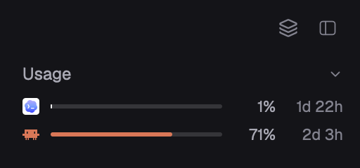

# T3 Limits

How much of each coding-agent subscription you have left, as T3 Code shows it. One row for each provider that reports a limit (Codex, Claude Code, Grok Build, Cursor, OpenCode Go, Antigravity). Each row has the provider's icon, a thin bar for the window closest to its limit, the percent used and when that window resets ("2d 3h"). Click a row to see every window with its exact reset time. For Claude Code and Codex the same card keeps several saved accounts side by side, each with its own limits. On its own it is a 28px bar across the top of your window. In the T3 layout it sits at the top of the left sidebar and folds to one line. A provider with nothing to show has no row. When no provider has anything, the strip draws nothing.



This file is the brief: enough to build T3 Limits from an empty folder. The files next to it are one build of it. If they don't work on your Herdr, or you want it different, build it again from here.

## What you see

**As a top bar** (on its own, `place: "top"`, 28px): the theme's `chrome` background with 8px side padding. The rows sit side by side, 12px apart, each 196px wide. With no rows the bar is empty.

**In a sidebar** (with `props.node`, as in the T3 layout), top to bottom on `chrome`:

1. **The heading**, 26px tall, with 16px left and 12px right padding. "Usage" is on the left in 12px medium `muted`. An 11px `dim` chevron is on the right, pointing down when open and right when folded. When folded, the tightest window of all providers sits before the chevron: that provider's 11px icon, its percent and its reset time, both in 11px.
2. **One 20px row per provider that has at least one window**, with 16px left and 12px right padding and 8px gaps. Rows follow T3's order: Codex, Claude Code, Grok Build, Cursor, OpenCode, Antigravity. Each row has a 12px icon, a 3px bar that fills the rest, the percent used (30px wide, right-aligned, 11px `muted`) and the time to reset (40px wide, right-aligned, 11px `dim`). Under the pointer a row gets a `hover` fill with 4px corners.
3. **6px of space** under the last row.

The block is exactly as tall as that: 26px plus 20px per row plus 6px, or 28px when folded. With no rows it is hidden (zero height).

**The bar**: a `border` track with 3px corners. The fill shows the used share of the window, in the provider's color from T3's `usageProviders.ts`:

| Provider | Color |
| --- | --- |
| Claude Code | `#d97757` |
| Cursor | `#8b8b8b` |
| OpenCode | `#5b9bbd` |
| Antigravity | `#8c7bd1` |
| Codex | the theme's `foreground` (T3's contrast foreground) |
| Grok Build | the theme's `muted` (T3's 72% contrast foreground) |

At 75% used, the fill and the percent turn `ansi3` (yellow). At 90% they turn `blocked`.

**Icons** are Herdr's shipped ones in `icons/`. `codex.svg`, `claude.svg` and `antigravity.svg` are drawn as full-color pictures. `grok.svg`, `cursor.svg` and `opencode.svg` are glyphs tinted in the provider's color.

**Reset times** follow T3: `2d 4h`, `4h 12m`, `12m`, and `now` once the reset has passed.

**The card** (opened by clicking a row): 300px wide, 10px padding, 10px corners, a `popover` fill and a `border` line, 12px text. It contains:

- The provider's 14px icon and name in medium `foreground`.
- Each window: its label in `muted` ("5h", "Weekly", "Weekly · Fable", "Monthly spend", "Monthly credit limit", "Overall", "Cursor Models", "Gemini · 5h") with the percent on the right, then a 4px bar, then "Resets in 1d 18h · Thu Nov 5, 07:59" in 11px `dim`.
- For Claude Code and Codex, the windows come per account. Each account has a 20px line: an 11px `accent` check on the account new agents use, the name ("Default", or the name it was saved under), then "Use for new agents" and "Remove" as 11px `muted` text buttons with a `hover` fill. An account without windows says "Not signed in yet: finish the login in its tab." Under the accounts are "+ Add account" and the note "The checked account applies to new agents from the New menu. Running agents keep theirs."
- Last, "Read 3m ago". If a read failed, it adds "a read failed, retrying".

When saved accounts exist, a row also shows the shown account's name in 11px `dim` (at most 64px) after the icon.

## How it behaves

- **On load** it shows the last good values at once (from local storage), finds which providers this machine has, and reads each one.
- **Every 5 minutes** it reads each provider again. When a read fails, the provider keeps its last good windows, and the wait before the next try doubles each time: 10, 20, 40, then 60 minutes.
- **Clicking a row** opens its card, and reads that provider again unless its last read is under 30 seconds old. Clicking the same row again closes the card. Clicking another row switches to that row's card. Esc or a click outside closes it.
- **Clicking the heading** folds the rows to one summary line, or opens them again. The block resizes to fit, and the choice is remembered.
- **A provider appears** once a read returns at least one window, and **disappears** when a read returns none. The block shows, resizes or hides to match.
- **A row's numbers** come from the account new agents use, else from Default, else from the first saved account that has windows.
- **Add account** asks for a name in the card. Enter or Add makes the account's home folder and opens a tab in the current space running that provider's own login with the home set: `env CLAUDE_CONFIG_DIR=<home> claude auth login` or `env CODEX_HOME=<home> codex login`. When the login writes its file (`.claude.json` or `auth.json`), the account is read and its bars appear.
- **Use for new agents** marks one account for each provider, or Default. Agents already running keep theirs.
- **Remove** asks first in Herdr's `confirm` dialog, then deletes only that account's home folder. Removing the active account falls back to Default. Default can't be removed.
- **A window whose reset time has passed** counts as 0% used until the next read.
- **Motion:** when a new reading arrives, the bar's width moves over 300ms ease-out. The reset times redraw every minute. Nothing else animates.

## Built from

- **One mod**, `mods/t3-limits/`, with `main.js`, `accounts.js` (shared with `t3-new-menu`) and `check-limits.cjs`. Its `mod.json` is `{ "place": "top", "size": 28, "title": "Usage limits" }`, so it docks itself as a bar across the top of any layout. It has no keys.
- **Props:** `node` is the id of the layout block the mod sits in. With it, the mod draws the sidebar version and fits the block. After a read and on fold, it runs `layout.resize { id: node, px }`, `layout.show` when the first row appears and `layout.hide` when the last one goes. It never does this while drawing. Without `node` it draws the top bar and never resizes.
- **Herdr functions:** `exec`, `readTextFile`, `watchFolder`, `home`, `appHome`, `theme`, `props`, `run`, `shared`, `setShared`, `focused`, `openOverlay`, `notify`, `nextCommand`. `fetch` and `localStorage` are built in. From `gpui-base`: a controlled `Popover` (`.anchor("top_left").open(…).on_open_change(…)`), `InputState`, `Input`, `v_flex` and `h_flex`.
- **The card's open state** is the mod's own, set from `on_open_change`. A press on the open row's trigger can report a close (the press outside the card) followed by an open (the press on the trigger). An open for the same row within 400ms of its close is ignored, so the second click closes the card.
- **Local storage:**
  - `cache`: each provider's last good windows and when they were read (labels, percents and reset times, nothing else).
  - `collapsed`: whether the sidebar version is folded.
- **Timers:** one every 5 minutes for the reads, one every minute for the reset times. Reads run in `cx.spawn`, one round at a time.
- **The data model is T3's** `ServerProviderUsageWindow`: `{ id, label, used (0-100), resetsAt (ms or null), mins (window length or null) }`. A row shows the window with the highest `used`.
- **Which providers to read:** one `exec("sh", ["-c", …])` runs before each round. It prints a provider's name when its CLI is found or its data file or folder exists:

  | Prints | When |
  | --- | --- |
  | `claude`, `codex`, `opencode`, `grok` | `command -v` finds the CLI |
  | `codex` | `~/.codex/sessions` exists |
  | `opencode` | `~/.local/share/opencode` exists |
  | `grok` | `~/.grok/auth.json` exists |
  | `cursor` | `~/.cursor/auth.json` or `~/.config/cursor/auth.json` exists |
  | `antigravity` | `~/.gemini/antigravity` or `~/.gemini/antigravity-acp/acp_token.json` exists |

### Claude Code

Read as T3's capabilities probe does it (`ClaudeProvider.ts`, `claudeUsageLimits.ts`).

- **How it asks:** `sh -c` feeds two stream-json control requests, `initialize` and `get_usage` with `skip_behaviors: true`, to the command below as a here-document. The shell runs it with `exec`, so the shell becomes `claude`, and if the 30-second exec limit stops it, `claude` stops too.

  ```sh
  claude -p --input-format stream-json --output-format stream-json --verbose --no-session-persistence \
    --settings '{"disableAllHooks":true}' --strict-mcp-config --mcp-config '{"mcpServers":{}}'
  ```

  The environment sets `ENABLE_CLAUDEAI_MCP_SERVERS=false`, `CLAUDE_CODE_AUTO_CONNECT_IDE=0` and `CLAUDE_CODE_IDE_SKIP_AUTO_INSTALL=1`.
- **No model runs**, because no prompt is sent. The CLI answers both requests and exits in about 1.3s.
- **What it keeps:** only the line with `"request_id":"usage"`. Everything else is dropped.
- **Windows** from `rate_limits`. The percents are already 0-100.
  - `five_hour` becomes 5h.
  - `seven_day` becomes Weekly.
  - Each `model_scoped` entry becomes Weekly · its name.
  - Monthly spend comes from `spend` when used and limit share a currency and exponent. Otherwise it comes from `extra_usage`.
- **No row** when the answer has `rate_limits_available: false` (an API-key login).

### Codex

Read as T3 does it (`CodexProvider.ts`, `codexUsageLimits.ts`).

- **How it asks:** it sends `initialize`, `initialized` and `{"id":2,"method":"account/rateLimits/read"}` to `codex app-server` on stdin.
- **Holding stdin open:** the app-server quits as soon as its input closes, before it answers. So the script starts it in the background, reading a fifo in a `mktemp -d` folder, and writes the requests into the fifo. It keeps the fifo open until the answer lands in a file in the same folder, checking every 0.1s and giving up after 10s. A `trap` on exit, and on TERM, INT and HUP, kills the app-server by its PID and removes the folder, so it never outlives the script.
- **Which snapshot:** `rateLimitsByLimitId.codex`, else `rateLimits`.
- **Window names:** `primary` and `secondary` are positions, so the window length decides the name: Monthly for 30 days or more, Weekly for 7 days or more, otherwise "5h". With no length given, a paid plan means 5h and weekly, and Free or Go means a month.
- **Skipped:** a `limitId` other than `codex`, which is one model's own limit.
- **Extra window:** `individualLimit` becomes Monthly credit limit.
- **Fallback:** if the app-server doesn't answer, it reads the newest rollout under `~/.codex/sessions` (rollout paths sort by start time) and takes its last `"rate_limits"` line. That line is a `token_count` event in snake_case (`used_percent`, `window_minutes`, `resets_at`).

### Grok Build

Read as T3 does it (`provider-grok/usageLimits.ts`).

- **Configs that send nothing:** it first reads `~/.grok/config.toml`, `managed_config.toml`, `requirements.toml`, and `/etc/grok/managed_config.toml` and `requirements.toml`. If any of them has an `auth`, `grok_com_config` or `endpoints` section, that config picks another account or endpoint, and nothing is sent.
- **The login:** from `~/.grok/auth.json` it reads only the account under `https://auth.x.ai::b1a00492-073a-47ea-816f-4c329264a828` or `https://accounts.x.ai/sign-in`. A login with `auth_mode: "api_key"` is skipped.
- **The request:** the login's `key` goes to `GET https://cli-chat-proxy.grok.com/v1/billing?format=credits` with `Authorization: Bearer`.
- **The window:** `config.creditUsagePercent` and `config.currentPeriod` become one Weekly, Monthly or Subscription window that resets at `currentPeriod.end`. Grok leaves out a 0% but keeps the period, so a full period with no percent reads as 0%.

### Cursor

Read as T3 does it (`provider-cursor/usageLimits.ts`).

- **The login:** `accessToken` from `~/.cursor/auth.json` or `~/.config/cursor/auth.json`.
- **The request:** the token goes to `POST https://api2.cursor.sh/aiserver.v1.DashboardService/GetCurrentPeriodUsage` with `Authorization: Bearer`, `connect-protocol-version: 1`, `x-cursor-client-type: cli` and a `{}` body.
- **The windows:** `planUsage.totalPercentUsed`, `autoPercentUsed` and `apiPercentUsed` become Overall, Cursor Models and Other Models. All three reset at `billingCycleEnd` (ms).
- **No Keychain:** by default, Cursor on macOS keeps its login in the Keychain (`cursor-access-token`). T3 reads that only after the person turns it on. Here a row can't ask before it exists, so a Keychain login has no row and the Keychain is never touched.

### OpenCode Go

Read as T3 does it (`provider-opencode/usageLimits.ts`).

- **The keys,** in T3's order:
  1. `sqlite3 -readonly -json -cmd ".timeout 100" ~/.local/share/opencode/opencode.db` selects the active `credential` rows for `opencode` and `opencode-go`. It keeps a `{type:"key"}` row whose `metadata.server` is absent or is `https://opencode.ai/console`.
  2. The `"opencode-go"` `{type:"api"}` key in `~/.local/share/opencode/auth.json`.
- **The request:** each key is tried against `GET https://opencode.ai/zen/go/v1/usage` with `Authorization: Bearer`. A 401 or 403 moves on to the next key.
- **The windows:** `usage.rolling`, `weekly` and `monthly` (`percent`, `resetsAt`) become 5h, Weekly and Monthly.
- **No row** without a Go key or a Go plan.

### Antigravity

Read as T3 does it (`antigravityUsageLimits.ts`).

- **The login:** `~/.gemini/antigravity-acp/acp_token.json` (`client_id`, `client_secret`, `refresh_token`, `project_id`).
- **Getting an access token:** the refresh token goes to `POST https://oauth2.googleapis.com/token`. The access token it returns is fresh for each read and kept only for that read.
- **The request:** the access token goes to `POST /v1internal:retrieveUserQuotaSummary` on both `https://daily-cloudcode-pa.googleapis.com` and `https://cloudcode-pa.googleapis.com`, with body `{ project }`.
- **Families:** buckets are grouped by their id. `gemini-argon-…` uses its group's name, `gemini-…` is Gemini, and `3p-…` is "Claude & GPT (shared)".
- **The windows:** a bucket's `window` is `5h` or `weekly`, and used is `1 - remainingFraction`. An untouched bucket (nothing used, reset exactly one window from now) gets no reset time. Each id keeps its most-used reading across the two hosts.
- **Fallback:** with no buckets, it asks `fetchAvailableModels` for each family's Reported quota and Weekly, without inventing a window length.

### Saved accounts

They follow T3's extra Claude and Codex instances (`ClaudeHome.ts`, `CodexHomeLayout.ts`, `CodexManagedHome.ts`, `AddCodexAccountDialog.tsx`). T3 supports more than one account for these two providers only.

- **The home folder:** each account is a folder of the CLI's own. T3 keeps its homes under T3's state folder. A mod can't use that folder, so they go to `~/.config/herdr-app/data/t3-limits/accounts/<provider>/<id>`. The id comes from the name ("Work" becomes `work`, then `work-2`).
- **Claude** gets `CLAUDE_CONFIG_DIR=<home>`, not `HOME`, so its macOS Keychain login still works. Claude keeps a Keychain entry for each config folder.
- **Codex** gets `CODEX_HOME=<home>`, set up as T3's auth overlay. The home links every entry that already exists in `~/.codex`, except `auth.json`, `auth.lock`, `models_cache.json`, `log`, `memories`, `tmp` and `.DS_Store`. So config, sessions and skills stay shared, and only the login is the account's own. Nothing is ever created in `~/.codex`. If `~/.codex` lacks one of `sessions`, `archived_sessions`, `sqlite`, `shell_snapshots`, `worktrees`, `skills`, `plugins`, `cache` or `logs`, that folder is made in the account's own home instead. The links are refreshed before each read, adding only the missing ones.
- **Reading an account:** the same Claude and Codex probes run with the account's home, passed as `$1` to `sh -c`, never written into the script. While Codex has saved accounts, the rollout fallback is off, because rollouts are shared between accounts.
- **Watching a login:** after Add account, the mod watches the new home with `watchFolder`. Reading an account writes files into its home too, so only a change to the login file (`.claude.json` for Claude, `auth.json` for Codex) counts. At most one read starts every 15 seconds, through the same one-round guard as the timer. Watching stops once the account has windows, or once it is removed.
- **Which entries count:** shared state is open to any mod, so an entry counts only if its id matches `^[a-z0-9-]+$` and its home is exactly `accounts/<provider>/<id>` in the Herdr folder. Any other entry is ignored everywhere: it gets no row, no read, no overlay links, no `env` in `t3-new-menu` and no delete. `accounts.js` holds this check, with `ACCOUNT_ENV`, `accountsDir`, `validAccount`, `activeAccount` and `accountArgv`.
- **The store:** shared `limits.accounts`, `{ claude: { active: "<id>" | null, accounts: [{ id, label, home }] }, codex: … }`. It holds ids, labels and paths, never credentials. `active: null` is Default, which sets no variable.
- **New agents:** the copy of `accounts.js` (`ACCOUNT_ENV`, `activeAccount`, `accountArgv`) in `t3-new-menu`, the T3 layout's New menu, turns an agent's `run` into `env CLAUDE_CONFIG_DIR=<home> claude …` or `env CODEX_HOME=<home> codex …` for an agent started on this computer. "Use for new agents" shows only when `mods/t3-new-menu/accounts.js` exists, because Herdr's own New menu doesn't read the choice.
- **Removing:** each confirm gets a fresh 16-hex nonce, and the `confirm` dialog runs `t3-limits.remove-<nonce>`, which the mod takes through `nextCommand()`. The delete runs only when the nonce matches and the confirm is under 60 seconds old. Any other `remove…` command disarms it, and so does opening a card, so a cancelled confirm can't delete later. It deletes the account's folder with `rm -rf --`. Removing a symlink doesn't touch its target, so `~/.codex` is safe.

### Pi and Muse Code

T3 has nothing a mod could read for these two, so they never have a row:

- For **Pi**, T3 reads only token usage, not limits.
- For **Muse Code**, T3 learns the limits only from a live session's 429 refusals.

### Tests

`check-limits.cjs` (`node check-limits.cjs`) loads `main.js` into a `vm` with a fake Herdr (`exec`, `readTextFile`, `fetch`, `localStorage`, `run`). Small fixtures check:

- each source's parse into windows
- the tightest pick and the reset text
- hidden providers and the zero-height strip
- folding, backoff and the rollout fallback
- Grok's custom-config and API-key skips
- that every made-up credential reaches only its own host and never storage or the rows
- that a second click on the open row closes its card
- for accounts: the store holds only ids, labels and paths, the login tab runs with the account's home, the active account wraps argv while Default adds no variable, and removing deletes only that account's folder and falls back to Default
- that `t3-new-menu`'s `accounts.js`, when it is next to this mod, is the same file

### What it reaches outside its folder

Tell the person these before adding it.

- **Programs** (through `exec`): `sh`, `claude` (`-p` with stream-json, as above), `codex app-server`, `sqlite3 -readonly` on OpenCode's database, `find`, `sort`, `grep`, `mktemp`, and for accounts `mkdir`, `ln -s` and `rm -rf` on an account's own folder.
- **Tabs it opens:** one per added account, running `claude auth login` or `codex login` with that account's home. The login opens your browser.
- **Files read:**
  - `~/.codex/sessions/**/rollout-*.jsonl` (rate-limit lines only)
  - `~/.grok/auth.json` and Grok's config files
  - `~/.cursor/auth.json`
  - `~/.local/share/opencode/auth.json` and `opencode.db`
  - `~/.gemini/antigravity-acp/acp_token.json`
- **Files written:**
  - each saved account's home folder under `~/.config/herdr-app/data/t3-limits/accounts/`. The CLI keeps that account's login there (Claude's in the Keychain).
  - for Codex accounts, the links to `~/.codex`, made inside the account's home. Nothing is written in `~/.codex` itself.
  - a temp file that `codex` writes and the script deletes.
- **Network, from the mod.** Each credential goes only to its own provider's hosts:

  | Credential | Hosts |
  | --- | --- |
  | Grok key | `cli-chat-proxy.grok.com` |
  | Cursor token | `api2.cursor.sh` |
  | OpenCode Go key | `opencode.ai` |
  | Antigravity login | `oauth2.googleapis.com`, `cloudcode-pa.googleapis.com`, `daily-cloudcode-pa.googleapis.com` |

- **Network, from the CLIs it runs:** `claude` calls Anthropic and `codex` calls OpenAI with their own logins, just as they do when you use them.
- **Keychain:** the mod never touches it. `claude` reads its own login, as it does on every start, with no prompt.
- **Credentials** never go into local storage, shared state, labels, logs or the screen. Accounts never involve them: the CLIs sign in and keep their logins in their own homes.

## Watch out

- **Antigravity, Cursor and Grok are read from the providers' internal endpoints**, the same way T3 Code reads them. For Antigravity that means presenting itself as Google's Antigravity app, with its client and User-Agent. These endpoints aren't public, so they may change and break the reading without warning, and using them may conflict with the providers' terms.
- **Codex accounts aren't fully separate.** They share config, history and MCP sign-ins with `~/.codex` through links. Only the ChatGPT login itself is the account's own.
- **Each saved account is read every 5 minutes**, by running `claude -p` or `codex app-server` with its home. Each read writes a few small files into that home.
- **`codex app-server` answers only while its input is open.** A plain `printf … | codex app-server` gets nothing back. Hold the input open until the answer arrives, with a time limit.
- **`claude -p` without the flags** runs your SessionStart hooks and MCP servers on every read. Keep `disableAllHooks`, the empty strict MCP config and `--no-session-persistence`.
- **The Claude stream's first reply has the account's email.** Read only the `usage` line and keep nothing else.
- **Rollout data is old.** It is only as fresh as the last Codex session, which is why the live app-server read comes first.
- **A hidden row can't ask for anything.** No provider may need a click (a Keychain prompt, a sign-in) before it has data, because a provider without data has no row to click.
- **A vm test sees a separate realm.** Arrays made inside it fail `deepStrictEqual` against plain ones, so the test compares them as JSON.
- **The mod sets the sidebar block's height.** The layout's `size.px` is only the starting height. The mod resizes, shows and hides the block itself, so it needs the block's own id in `props.node`.
- **Grok, Cursor, OpenCode Go and Antigravity are untested against their servers.** Their parsing is checked with fixtures. No real login for any of them was available while building.
- **Grok's environment overrides aren't read.** T3 also skips Grok when `XAI_API_KEY` or one of the `GROK_*` auth or endpoint variables is set. A mod can't see Herdr's environment directly, so only the config files decide.
- **The card opens below its row** (`top_left` anchor). In a top bar that means below the bar.
- **A second click on a row could reopen its card.** The card's outside-press close and the trigger's open can both come from one press, so ignore an open for the same row just after its close.
- **The account choice needs `t3-new-menu`'s copy of `accounts.js`.** Herdr's own New menu, and agents started any other way, use the default login.
- **Removing a Claude account leaves its Keychain entry.** Run `claude auth logout` with that home first to clear it.
- **Every Claude read starts the `claude` CLI** (about 0.8s of CPU). That happens every 5 minutes while the mod is in the layout, shown or not.

## Done when

- `herdr-app check mods/t3-limits` passes, and `node check-limits.cjs` passes all its tests.
- On a machine signed in to Codex and Claude Code, the rows show the same percents as `/status` in Codex and `/usage` in Claude Code, with matching reset times.
- A provider that isn't installed, or has nothing to read, has no row. With none at all, the sidebar block is hidden and the top bar is empty.
- Clicking a row shows every window with its exact reset time, and its card says "Read just now". Clicking it again closes the card.
- Add account opens a login tab with the account's home set. After signing in there, the account's bars appear in the card. Use for new agents moves the check, and a Claude agent started from the T3 New menu runs with `CLAUDE_CONFIG_DIR` set to that home. Remove deletes that folder and the check returns to Default.
- In a sidebar with `props.node`, clicking the heading folds to one line, the block shrinks to 28px, and it stays folded after a reload.
- With the network off, the last numbers stay, and the card says the last read failed.
- Searching local storage and `herdr-app status` for any token from the files above finds nothing.
