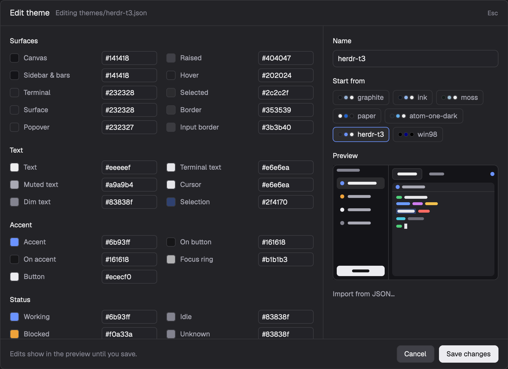

# T3 Theme

A dialog for making a Herdr theme or editing one you made. Every theme color has a swatch and a hex field, a small picture of a Herdr window shows the edits as you type, and Save writes `themes/<name>.json` and switches to it. Nothing changes until you save. This is a piece you add to your current layout, not a whole window.



This file is the brief: enough to build T3 Theme from an empty folder. The files next to it are one build of it. If they don't work on your Herdr, or you want it different, build it again from here.

## What you see

A modal dialog, 880 by 640, on the theme's `popover` background with 12px text.

1. **The header**, 44px, 16px side padding, a `border` line under it. "Create theme" or "Edit theme" in 14px semibold `foreground`. Next to it in `dim`: "New file themes/aurora.json", "Editing themes/aurora.json", or "Name the theme" while the name is empty. "Esc" at the right in 11px `dim`.
2. **The colors**, the left side, scrolling, 16px padding and 16px between groups. Each group has a 12px semibold title and its fields in two columns 16px apart:

   | Group | Fields (key: label) |
   | --- | --- |
   | Surfaces | canvas: Canvas, chrome: Sidebar & bars, background: Terminal, surface: Surface, popover: Popover, raised: Raised, hover: Hover, selected: Selected, border: Border, input: Input border |
   | Text | foreground: Text, muted: Muted text, dim: Dim text, terminal_foreground: Terminal text, cursor: Cursor, selection: Selection |
   | Accent | accent: Accent, accent_foreground: On accent, solid: Button, solid_foreground: On button, ring: Focus ring |
   | Status | working: Working, blocked: Blocked, done: Done, idle: Idle, unknown: Unknown |
   | Terminal ANSI | ansi0 to ansi15: Black, Red, Green, Yellow, Blue, Magenta, Cyan, White, then the same with "Bright " |

   A field row is 28px: a 16px swatch with 4px corners and an `input` border, the label in `muted`, and a 96 by 24 hex field with 5px corners on `background`. An invalid value turns the label to "Label · invalid" and the label, field border and text to `blocked`, and its swatch goes transparent.
3. **The side**, 320px, 16px padding, a `border` line on its left, 14px between sections, each with a semibold `foreground` heading:
   - **Name**: a 30px field, placeholder "e.g. Aurora".
   - **Start from**: a chip per theme Herdr knows, 26px high. Three 8px dots (its background, accent and foreground) and its name. The chip loaded now has an `accent` border and a `selected` fill.
   - **Preview**: a 200px picture in the edited colors. A 96px sidebar on `chrome` with four agent rows whose dots are `working` (on a `selected` row), `blocked`, `done` and `idle`, and a `solid` button at the bottom. A tab row with the active tab on `surface` and an `accent` dot at the right. A terminal on `background` with a header line (a `working` dot), then short bars in `ansi2`, `terminal_foreground`, `ansi4`, `ansi5`, `ansi3`, `ansi1`, `ansi6` and `ansi8`, one bar on `selection`, and a `cursor` block.
   - **"Import from JSON…"**, a `muted` link.
4. **The footer**, 52px, a `border` line above it. On the left in `dim`: "Edits show in the preview until you save." Errors and "3 invalid colors" replace it in `blocked`. On the right, Cancel on `raised` with an `input` border, then "Create theme" or "Save changes" on `solid` in `solid_foreground`. Both buttons are 30px with 7px corners and go to 88% opacity on hover.

## How it behaves

- cmd-shift-t (`mod.open:t3-theme`) opens it. The name field has focus.
- It starts from the theme shown now: every field gets that theme's resolved color. If `themes/<name>.json` exists in the Herdr folder, you are editing that file under its own name. If not (a built-in theme), the name becomes `<name>-custom` and Save makes a new file.
- Clicking a Start from chip loads that theme the same way and drops unsaved edits.
- Typing a hex value updates its swatch and the preview at once. `#rgb`, `#rrggbb` and `#rrggbbaa` are valid.
- The name becomes the file name: lowercase, every run of other characters turned into `-`, no `-` at the ends. "Edit theme" shows only while that name is the file that was loaded. Renaming makes it a new file.
- "Import from JSON…" swaps in a 5-row box ("Paste a theme JSON file") with Close and Apply JSON. Apply takes a theme file, or a flat `{ "accent": "#6b93ff" }` map such as a dump of `theme()`, and fills the fields it names. A top-level `foreground` counts as terminal text unless the JSON also names `terminal_foreground`. Errors read "Import failed: Paste a JSON object." or "Import failed: No theme colors found."
- Save checks the name ("Name the theme first.") and the colors ("3 invalid colors: use #rgb, #rrggbb or #rrggbbaa."). A new file never replaces an existing one ("aurora" already exists. Pick it under Start from to edit it.) or takes a built-in name ("graphite" is a built-in theme. Pick another name.). Then it writes the file, runs `app.theme` with the name and closes.
- Cancel and Esc close it. The previous theme stays.

There are no agent statuses here beyond the status colors themselves, and nothing moves.

## Built from

- **One mod**, `mods/t3-theme/`. `mod.json`:

  ```json
  { "place": "none", "title": "Create theme",
    "overlay": { "kind": "dialog", "modal": true, "width": 880, "height": 640 } }
  ```

  Files: `main.js` (the view), `theme-file.js` (the groups and the file format, no Herdr imports) and `check-theme.cjs`, which runs `theme-file.js` under Node.
- **A `keys.json` snippet**, merged into the person's:

  ```json
  { "global": { "cmd-shift-t": "mod.open:t3-theme" } }
  ```

- **The file it writes** has Herdr's theme shape. Terminal colors go at the top, everything else under `colors`, every value lowercase and `#abc` expanded to `#aabbcc`:

  ```json
  { "background": "#232328", "foreground": "#e6e6ea", "selection": "#2f4170", "cursor": "#e6e6ea",
    "ansi": ["#3a3a40", "…16 in all"], "colors": { "canvas": "#141418", "foreground": "#eeeeef", "…": "…" } }
  ```

  The top-level `foreground` is the editor's Terminal text. Text goes to `colors.foreground`.
- **Herdr functions:** `theme`, `themes` (names and resolved colors for the chips and the start values), `settings().theme`, `appHome`, `readTextFile`, `writeTextFile`, `run("app.theme")`, `props().overlay` and `closeOverlay`. From `gpui-base`: `InputState`, `Input`, `TextareaState`, `Textarea`.
- **Saving:** `writeTextFile(path, text, expected)`. When editing, `expected` is the text read at load, so a file changed on disk since is refused rather than overwritten. A new file passes `null`, which refuses an existing file.
- **No art.**

What it reaches outside itself, to tell the person before adding:

- **Files:** it reads `themes/<name>.json` and writes `themes/<slug>.json` in the Herdr folder (`appHome()`), outside its own mod folder.
- **Programs, network, clipboard:** none.

## Watch out

- **The person sees theme files appear.** Each Create adds a file to `themes/`. Nothing here deletes one.
- **Saving writes every key**, including ones Herdr would otherwise derive from the base colors (`ring`, `colors.foreground`). The saved file pins them at the values shown.
- **Built-in themes have no file.** Editing one always means a new name.
- **A theme named like a layout belongs to that layout.** Herdr's Settings offers it only there. Pick another name for a theme meant for every layout.
- **Herdr's docs give theme colors as `#rrggbb`.** The editor also accepts `#rrggbbaa` and writes it as typed.
- **Esc is Herdr's.** The dialog closes on Esc because it is the top overlay. The mod has no key handler.

## Done when

- `herdr-app check mods/t3-theme` passes and `node --test mods/t3-theme/check-theme.cjs` passes.
- cmd-shift-t opens the dialog with the current theme's colors and name.
- Typing `#ff0000` into Accent turns the preview's accent dot red, and Cancel leaves the window's theme as it was.
- An invalid value marks its row and blocks Save with the count.
- Starting from a built-in theme and saving creates `themes/<name>-custom.json` and switches to it. The file has the top-level keys `background`, `foreground`, `selection`, `cursor`, `ansi` (16) and `colors`.
- Reopening on that theme shows "Edit theme" and "Editing themes/<name>-custom.json". Save changes rewrites the same file.
- Saving under a name whose file exists, or a built-in name, shows the error and writes nothing.
- Apply JSON with a pasted theme file fills the fields from it.
